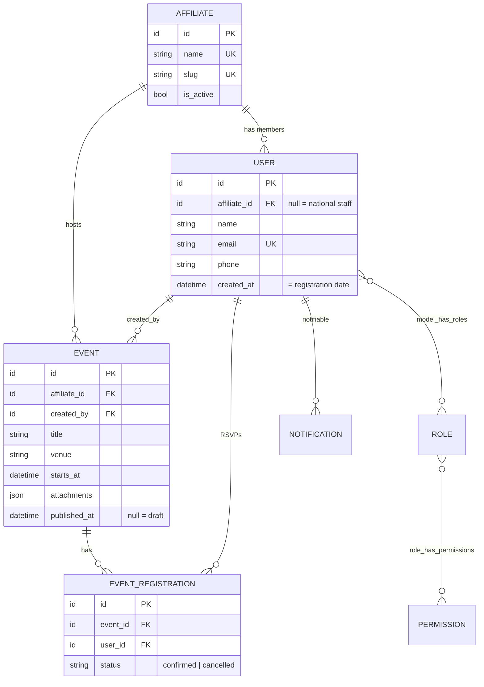

# Architecture: Integrated Digital Presence

Laravel 13 + Filament 5 (single `admin` panel) + Spatie Permission via Filament Shield. Hand-written; the generated code graph lives in `graphify/` and is rebuilt by `graphify update .` and `graphify export obsidian`.

## Tenancy model

One database, one panel. Every affiliate-owned row carries an `affiliate_id`. Affiliate data is stored at affiliate level and aggregated for national by querying across all `affiliate_id`s (no copies).

Filament's built-in tenancy and Spatie "teams" were **not** used: they change URLs and make the national all-affiliates view awkward.

Two layers decide access:

| Layer | Answers | Where |
|---|---|---|
| Permissions (Shield, `Action:Model`) | *What* may this role do? | `RolesAndPermissionsSeeder`, generated policies in `app/Policies` |
| Row scope `visibleTo($user)` | *Whose* rows may it do it to? | `User::scopeVisibleTo`, `Event::scopeVisibleTo`, called from each resource's `getEloquentQuery()` |

`national_admin` is the Shield super-admin (gate bypass, see `config/filament-shield.php`).

## Role x capability

| Capability | national_admin | national_user | affiliate_admin | affiliate_user |
|---|:-:|:-:|:-:|:-:|
| Open the panel | yes | yes | yes | yes |
| Update own profile | yes | yes | yes | yes |
| Receive notifications (bell) | yes | yes | yes | yes |
| Dashboard: members per affiliate (bar chart) | yes | yes | no (stat tiles show own count) | no |
| Dashboard: upcoming events | all | all | own | own (published) |
| Dashboard: recruitment by month | all | all | own | no |
| List members | all | all (read-only) | own affiliate (read-only) | no |
| Create / promote / demote affiliate admins | yes | no | no | no |
| Create & publish events | any affiliate | no | own affiliate | no |
| View events | all | all | own (incl. drafts) | own, published only |
| RSVP to events | n/a | n/a | own affiliate | own affiliate |
| Send alert (bulk action on members) | all | no | own members | no |
| Manage affiliates & roles | yes | view affiliates only | no | no |

## ER diagram

`event_registrations` has a unique key on `(event_id, user_id)`.

## Code map (links into the generated graph)

- Models: [[graphify/Affiliate|Affiliate]], [[graphify/Event|Event]], [[graphify/EventRegistration|EventRegistration]], [[graphify/User|User]]
- Resources: [[graphify/UserResource|UserResource]] (members), [[graphify/EventResource|EventResource]]
- Seeding of roles: [[graphify/RolesAndPermissionsSeeder|RolesAndPermissionsSeeder]]

## Adding things

- **New affiliate:** add it in the panel (Affiliates) or in `AffiliateSeeder::NAMES`.
- **New resource:** create it, then run `php artisan shield:generate --all --panel=admin`, add its permissions to `RolesAndPermissionsSeeder::MATRIX`, and scope its `getEloquentQuery()` with a `visibleTo` scope.
- **Demo data:** `php artisan migrate:fresh --seed` (Faker only; all demo accounts use password `password`: change before any real use).

## Open decisions / known limits

- Members are created by a national admin (no self-registration yet).
- Event attachments are stored on the `public` disk, so a file URL is world-readable if guessed, even for draft events.
- Membership data is politically sensitive: collect the minimum, keep it off public pages, and review data-protection obligations (Zimbabwe Cyber and Data Protection Act) before holding real records.
